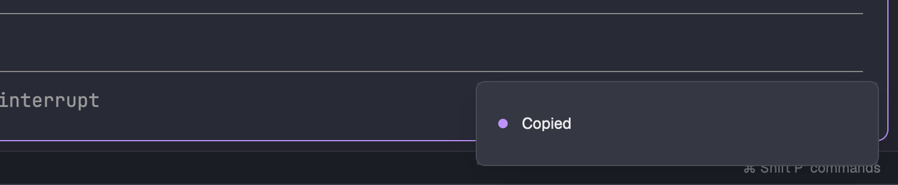

# Copy on Select

Select text in any terminal by dragging (or double/triple-clicking) and it's on the clipboard the moment you let go of the mouse, the way the Herdr TUI behaves. Nothing new appears in the window. Each copy posts Herdr's own "Copied" notification, the same toast that says an agent finished, which closes itself after 1.5 seconds.

## What you see

- Nothing permanent. The mod lives in an invisible 0px block docked at the bottom of the window.
- After each copy: the standard Herdr toast (drawn by the shipped `toast` mod) with the title **Copied**, at `success` level. That's a dot in the theme's `done` color (purple in Dracula) beside the word "Copied". It closes after 1500 ms.

## How it behaves

- **Left-drag in a terminal, then release:** one copy of the selection, one toast. It happens on release, not during the drag, and moving the pointer afterwards does nothing.
- **Double-click or triple-click** (word or line selection): one copy on release, even without movement.
- **Plain click** (moved 4px or less, single click): no copy, no toast.
- **Holding ⌘, ⌃ or ⌥ while pressing:** ignored. Shift is allowed, so Shift-dragging over a program that takes the mouse (vim, tmux) still copies.
- **Right and middle buttons:** ignored.
- **No terminal focused** (for example, a mod has focus): no copy.
- **A new press while an earlier one is still waiting:** the earlier one is dropped, so there's never more than one copy per release.
- Agent statuses aren't involved: it behaves the same for every terminal and agent.

## Built from

- **Folder:** `mods/copy-on-select/` with `main.js` and `mod.json` = `{ "place": "bottom", "size": 0 }`. Herdr docks one 0px block at the bottom of the shown layout the first time it sees the folder. No layout file and no `keys.json`.
- **View:** `main.js` default-exports a `View` whose `render` returns one `div().id("copy-on-select").size_full()` with `.on_mouse_down_out(handler)`. That's GPUI's capture-phase "press outside this element" listener. Because the element is 0px, every press anywhere in the window, terminals included, counts as outside. This is the only way a mod sees presses on terminals.
- **On a left press** with no ⌘/⌃/⌥ (`event.modifiers.platform/control/alt`):
  1. Bump a press counter, then record `event.position` and `event.click_count`.
  2. `cx.timer.every(40, …)` reads `window.mouse_position()` and marks the press as a drag once the pointer is more than 4px away from the press point on either axis.
  3. `cx.spawn(async …)` awaits `exec("osascript", ["-l", "JavaScript", "-e", SCRIPT])`. SCRIPT waits for the left button to come up, then exits: `ObjC.import("AppKit"); var t = 0; while (($.NSEvent.pressedMouseButtons & 1) && t < 3000) { delay(0.02); t++; } "up"`. That caps the wait at about 60 s.
  4. When it returns: cancel the timer, and stop if the press counter has moved on. Check the drag distance once more. If it was a drag or `click_count >= 2`, and `focused()?.terminal` is set, `run("terminal.copy")` and then `notify({ title: "Copied", level: "success", timeout: 1500 })`.
- **`herdr` functions:** `focused`, `run`, `notify`, `exec`. The only command is `terminal.copy`, which does nothing when nothing is selected.
- **Programs:** macOS `osascript` (JavaScript for Automation), one short process per press. No art.

## Watch out

- **Mods never see mouse releases.** `on_mouse_up` only fires on the mod's own element, there's no window-wide release listener, and `MouseMoveEvent` has no button state. Don't guess a release from the pointer stopping. Copying when the pointer settles copies again every time you move the mouse afterwards, which is the bug this design fixes. Ask the OS (`NSEvent.pressedMouseButtons`) instead.
- **Use one waiting `osascript`, not polling with `exec`.** It costs about 0.1 s to start. If the button is already up when it starts, it returns at once, which is still correct.
- **No `setTimeout`:** use `cx.timer` and `cx.spawn`. Never keep a `cx` for later.
- **`notify` timeout is in milliseconds.**
- **`mod.json` `size: 0` is accepted** and docks a 0px block. When docked on a layout's root row, Herdr wraps the old root in a new column with the block below it. That's expected.
- **macOS only.** `osascript` and `NSEvent` don't exist on Linux or Windows. There, swap step 3 for that platform's way of reading button state.
- **It can't tell whether anything was selected.** A left-drag that selects nothing, like dragging a pane divider, still runs `terminal.copy` (a no-op) and still shows the toast. If an old selection is still on screen, that drag re-copies it.
- **It's only active in layouts that contain its block.** Docking happens once, into the layout shown at the time. For another layout, add `{ "type": "block", "content": { "mod": "copy-on-select" }, "size": { "px": 0 } }` to it.

## Done when

- `herdr-app check mods/copy-on-select` passes, and `herdr-app status` shows no errors.
- The shown layout has a 0px block whose content is `{ "mod": "copy-on-select" }`.
- Dragging across terminal text and releasing puts exactly that text on the clipboard (`pbpaste`) and shows one "Copied" toast.
- After releasing, moving the pointer around for several seconds shows no more toasts.
- A double-click on a word copies the word, with one toast.
- A plain single click copies nothing and shows no toast.
- A ⌘-click or ⌥-drag shows no toast.
